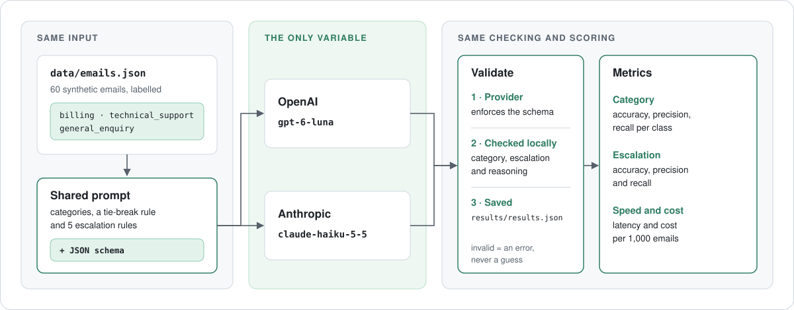

# Telecom Email Classification & Evaluation

An independent LLM evaluation project. All customers, emails and the telecom provider are synthetic.

## Overview

Customer emails arrive as unstructured text and need to reach the right team. This project sends 60 synthetic emails to one OpenAI model and one Anthropic model. Each model sorts them into `billing`, `technical_support` or `general_enquiry`. It also decides whether a person should review the email before anything happens. The project measures which model is more accurate, faster and cheaper.

```json
{"category": "billing", "escalate_to_human": true, "reasoning": "Customer disputes $240 in roaming charges, over the $100 review threshold."}
```

## Architecture



Both models receive the same prompt, emails and output schema. Every response is checked locally before it counts. Results are saved, so metrics can be recalculated without new API calls.

## Project Structure

```text
classifier.py        prompt, schema, API calls and response validation
evaluator.py         runs both models and calculates metrics
test_classifier.py   offline tests with mocked API clients
data/emails.json     60 synthetic emails with expected labels
results/             saved per-email results from each run
docs/                architecture diagram
```

## Key Design Decisions

- **One prompt, one schema:** the model is the only thing that differs between the two runs. Trade-off: neither prompt is tuned to its model.
- **Two layers of output checking:** each provider enforces the JSON schema, then `validate_response()` checks it again. Invalid output is recorded as an error and counted as wrong, never guessed.
- **Explicit tie-break rule:** a multi-topic email is labelled by what the customer wants done: money back is `billing`, something fixed is `technical_support`. Trade-off: some real emails need more than one label.
- **Written escalation rules:** the model escalates an email if any of five rules applies:
  - financial hardship
  - legal, credit or privacy risk
  - a complaint about staff
  - a customer about to leave
  - a dispute over $100

  Trade-off: written rules are predictable and testable, but they miss situations they don't name.
- **Fail on configuration, continue on blips:** a wrong key or model name stops the run immediately. A timeout or bad response is logged and the run continues.
- **Minimal dependencies:** the official SDKs, `python-dotenv` and `pytest`. Metrics are calculated by hand rather than with scikit-learn.

## Model Choice & Cost

I chose **gpt-6-luna** and **claude-haiku-5-5** for three reasons:

- Classification is a simple task, so it doesn't need a frontier model.
- Each is its provider's small, fast tier.
- Both list at $0.10 / $0.50 per million input / output tokens, so price doesn't favour either.

**Measured cost per 1,000 emails:**

| Model | Input tokens / email | Output tokens / email | Cost per 1,000 |
|---|---:|---:|---:|
| gpt-6-luna | 498 | 60 | $0.080 |
| claude-haiku-5-5 | 947 | 93 | $0.141 |

Equal list prices did not mean equal cost. Claude used about twice the input tokens, probably because Anthropic adds the schema to the prompt and its tokenizer counts the same text differently. It also wrote longer reasoning than the prompt asked for: 34 words against GPT's 20. I estimated $0.08 per 1,000 before the run, which was accurate for GPT but 43% too low for Claude.

At 1 million emails a month, that's about $80 against $141. Both are small next to the cost of a misrouted email. The full 120-call run cost $0.013.

**For production I'd choose claude-haiku-5-5.** Both models were equally accurate on categories, and Claude didn't miss any email that needed a person (see below). That matters more than $61 per million emails. The caveat: the difference comes down to a single email.

## Run the Evaluation

Python 3.10+. Copy `.env.example` to `.env` and add both API keys.

```bash
pip install -r requirements.txt
pytest                                 # 29 offline tests, no API calls
python evaluator.py --per-category 2   # quick run, 12 calls
python evaluator.py                    # full run, 120 calls
python evaluator.py --from-results     # re-report saved results for free
```

## Eval Results

One full run, 60 emails per model, 0 errors:

| Metric | gpt-6-luna | claude-haiku-5-5 |
|---|---:|---:|
| Category accuracy | 100.0% | 100.0% |
| Macro precision / recall | 100.0% / 100.0% | 100.0% / 100.0% |
| Escalation accuracy | 98.3% | 98.3% |
| Escalation precision | 100.0% | 88.9% |
| **Escalation recall** | **87.5%** | **100.0%** |
| Median latency (s) | 1.63 | 1.55 |
| Cost per 1,000 emails | $0.080 | $0.141 |

**What the results tell you:**
- **Categories are solved on this data.** Both models classified all 60 emails correctly, including the 9 deliberately ambiguous ones. The written tie-break rule did its job.
- **Escalation is where the models differ.** Each made one mistake, in opposite directions:
  - **GPT missed email 20** ($38 a month in repayments since June). It read the $100 rule literally because no total was stated.
  - **Claude escalated email 13 unnecessarily** ($4.99 a week in premium SMS charges). It reasoned that the total "may exceed $100 over time".
- **Claude's mistake is the cheaper one.** For escalation, recall matters most: a missed escalation reaches a customer unchecked, while a false alarm only costs a reviewer's time.
- **Speed is effectively equal:** about 1.6 seconds per email for both.

**What they don't tell you:**
- **Which model is better at categories.** At 100% each, the dataset is too easy to separate them. Harder or real emails are needed.
- **Whether the escalation gap is real.** It's one email each way. Only 8 emails should escalate, so a single email moves recall by 12.5 points.
- **Real-world performance.** The emails are synthetic, cleaner than real customer mail, and were written by the same person who labelled them.
- **Run-to-run variation.** Results come from a single run with default sampling, from one location at one time.

## Where It's Weakest

- **The $100 escalation rule is ambiguous.** It doesn't say whether it means the amount charged so far or the amount it could grow to. Both mistakes come from that gap: GPT ignored an implied total, and Claude projected a future one. The fix belongs in the rule, for example "the total charged so far". The new rule should then be tested on fresh emails, not these 60.
- **Rules are applied as written.** Both models handled hardship stated without the word "hardship" (email 19). Neither is likely to escalate a risk the five rules don't name.
- **Claude ignores length instructions.** It wrote 34-word explanations where the prompt asked for "one short sentence", which adds cost at scale.
- **Category weak spots are unknown.** No category mistakes means this dataset hasn't found them, not that there are none.
- **Labels come from one person.** Every category and escalation label is my judgement under the written rules.

## Before Real Customers (design only)

- **Real data:** evaluate on a few hundred real, anonymised emails labelled by support staff, with agreed accuracy targets per category.
- **Confidence and review:** send ambiguous or failed classifications to a human queue instead of routing them automatically.
- **Monitoring:** track accuracy, error rate, latency and cost over time, and re-run the evaluation before any model or prompt change.
- **Privacy:** remove or mask personal details before sending emails to a third-party API, and confirm each provider's data retention terms.
- **Reliability:** add rate limiting and a fallback to the second provider if one is unavailable.
